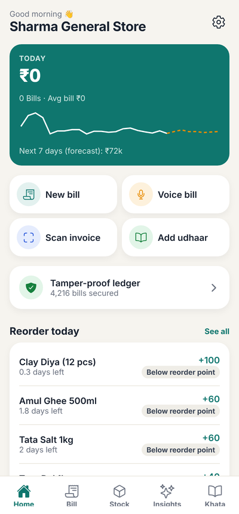
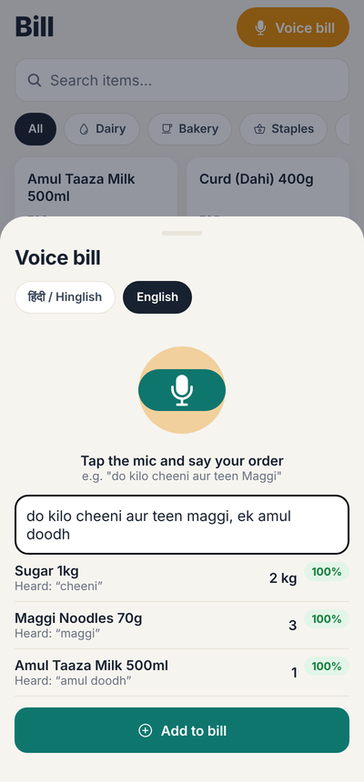
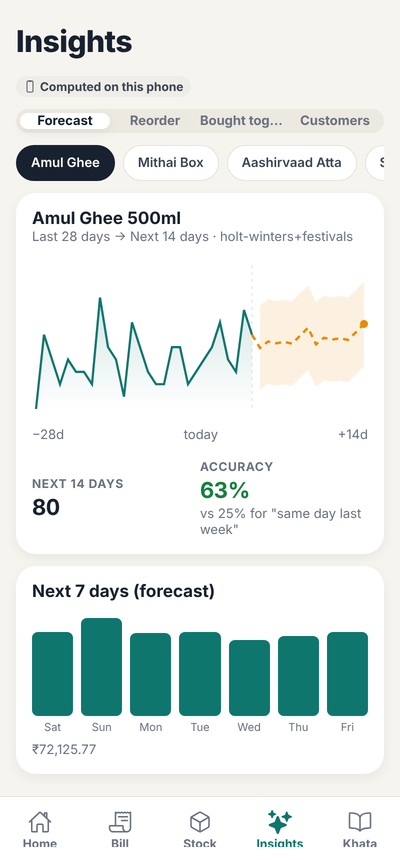
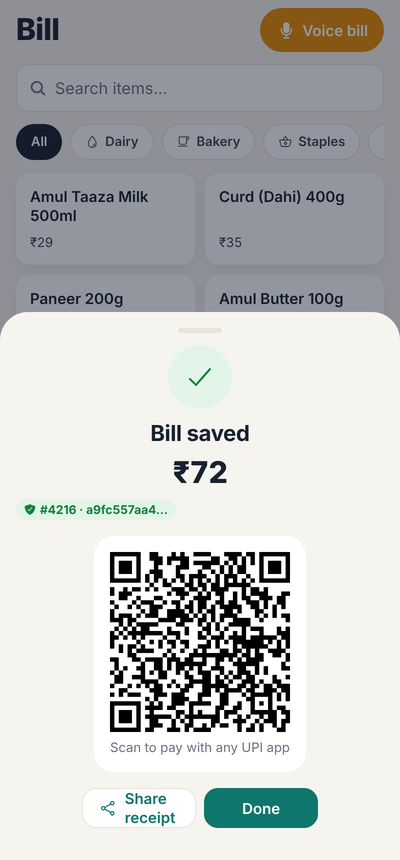

# Dukaan AI: Smart Retail OS for small shops

An Android app that gives India's ~13 million kirana stores **billing, stock and khata (credit) that think ahead**.
It uses on-device + AWS machine learning, Hindi/English voice billing, invoice scanning, and a **tamper-proof bill
ledger written in Rust**.

> Final-year project. It combines four problem statements from the course project bank: **#6 Retail Sales
> Forecasting, #40 Dynamic Inventory Replenishment, #35 Purchase-Pattern Mining, #27 Customer Segmentation**.

<p>




</p>

## What it does

| Feature | How |
|---|---|
| **Fast billing** | Tap-to-add grid, cash / UPI (with QR) / udhaar, WhatsApp receipt |
| **Voice billing (Hindi, English, Hinglish)** | On-device speech recogniser + a Hinglish parser ("do kilo cheeni aur teen Maggi", "ढाई किलो आलू"). Amazon **Bedrock** (Claude) is used as a fallback for hard sentences |
| **Invoice photo → stock** | Amazon **Textract** AnalyzeExpense reads supplier bills; a fuzzy matcher maps lines to items |
| **Festival-aware forecasting** (#6) | On phone: festival-adjusted Holt-Winters. In the cloud: gradient boosting with Indian festival, payday and weekday features |
| **Smart reorder** (#40) | Forecast-driven (s,S) policy with a newsvendor service level for perishables, rounded to supplier pack sizes |
| **Bought together** (#35) | Apriori on the phone; FP-Growth in the cloud |
| **Customer groups** (#27) | RFM + K-Means, with *k* chosen by silhouette score |
| **Udhaar risk** | Logistic model trained in Python, exported as coefficients and scored on the phone. Sends WhatsApp reminders with a UPI pay link |
| **Tamper-proof ledger** | Every bill is SHA-256 hash-chained on the phone. A **Rust** Lambda validates the chain and signs it with **Ed25519**. The phone verifies the signatures offline |
| **Offline-first** | SQLite is the source of truth on the phone. Everything works without internet; sync is idempotent |

## ML results (from [`ml/reports/REPORT.md`](ml/reports/REPORT.md))

| Task | Models compared | Result |
|---|---|---|
| Forecasting | Seasonal naive, moving average, Ridge, Random Forest, HistGradientBoosting, LightGBM, plus LightGBM *without* festival features | **LightGBM: 42% lower WAPE** than "same day last week". Festival features cut festival-day error by **27%** |
| Replenishment | Shopkeeper heuristic vs forecast (s,S) vs Q-learning | (s,S) is **26% cheaper**, with stockouts down from 141 to 32 SKU-days |
| Basket mining | Apriori vs FP-Growth | Identical itemsets. **100%** of the top-20 rules recover the planted baskets |
| Segmentation | K-Means, GMM, DBSCAN, Agglomerative | Silhouette 0.57, ARI 0.94 vs true personas |
| Udhaar risk | Logistic, Random Forest, Gradient Boosting | ROC-AUC 0.78, PR-AUC 0.48 (base rate 15%). Imbalance-aware metrics |

All numbers are reproducible: `cd ml && python run_all.py`.

## Architecture

```
Android app (Expo/React Native) ── offline SQLite, on-device ML, SHA-256 chain, Ed25519 verify
        │ HTTPS + Cognito JWT
API Gateway (HTTP API, JWT authorizer, throttling)
        ├─ λ sync ──► λ ledger-signer (Rust, Ed25519, key in Secrets Manager)
        ├─ λ insights ──► DynamoDB ◄── λ ml-batch (container, nightly via EventBridge) ──► SNS digest
        ├─ λ scan ──► S3 (5 MB, 30-day expiry) ──► Textract
        ├─ λ voice ──► Bedrock (Claude Haiku)
        └─ λ ledger-verify ──► λ ledger-signer
SageMaker (spot training job) · Budget alarm · CloudWatch logs (30 days)
```

See [docs/ARCHITECTURE.md](docs/ARCHITECTURE.md) (Mermaid diagram and data model) and [docs/LEDGER_SPEC.md](docs/LEDGER_SPEC.md).

## Get the APK

Every push to `main` runs **Build Android APK** and publishes the APK under **Releases**. On your phone, open the
latest release, download `DukaanAI-v1.0.x.apk`, and allow *Install unknown apps*. Then tap **Explore the demo shop**:
90 days of realistic data, fully offline.

## Deploy the AWS backend (about 10 minutes)

1. In the repo, go to **Settings → Secrets and variables → Actions** and add the secrets `AWS_ACCESS_KEY_ID` and
   `AWS_SECRET_ACCESS_KEY`. Use an IAM user for the project only. Using an OIDC role via the variable `AWS_ROLE_ARN`
   is preferred.
2. In the AWS console (Mumbai, `ap-south-1`), open **Bedrock → Model access** and enable Anthropic Claude Haiku.
3. Go to **Actions → Deploy AWS → Run workflow**. Optionally enter your email for the budget alert.
4. Copy the four outputs shown in the run summary into repository **variables** (`API_URL`, `AWS_REGION`,
   `USER_POOL_ID`, `USER_POOL_CLIENT_ID`). Then re-run **Build Android APK**, or paste the values in the app under
   **Settings → Cloud sync**.
5. Optional: run **Train demand model on SageMaker**.

**Release signing (before giving the app to real shops):** create a keystore once with
`keytool -genkeypair -v -keystore release.jks -alias dukaan -keyalg RSA -keysize 2048 -validity 10000`. Then add
the secrets `ANDROID_KEYSTORE_BASE64` (`base64 -w0 release.jks`), `ANDROID_KEYSTORE_PASSWORD`, `ANDROID_KEY_ALIAS`
and `ANDROID_KEY_PASSWORD`. Without them, the APK is a `-test` build signed with the public debug key.

**Cost:** everything is serverless (no always-on SageMaker endpoint). A demo month typically stays within free-tier
or credits. The budget alarm emails you at 80% of the limit. `cdk destroy` removes everything when `demo_mode=true`.

## Run the tests

| Part | Command | Tests |
|---|---|---|
| Rust ledger | `cd ledger && cargo test && cargo clippy -- -D warnings` | 41 |
| ML pipeline | `cd ml && pip install -r requirements.txt && pytest --cov` | 31 (97% coverage) |
| Backend | `cd backend && pytest --cov` (builds the real Rust signer CLI) | 44 (95% coverage) |
| App | `cd app && npm ci && npm test` | 84 (≈99% line coverage on logic) |
| Infra | `cd infra && npm ci && npx jest` | 13 |

**Cross-language guarantee:** `spec/ledger-vectors.json` is generated by an independent Python implementation, and the
Rust, TypeScript and backend suites all reproduce it byte for byte, including Ed25519 signatures that verify on the
phone.

## Repository

```
app/      Expo React Native app (TypeScript): screens, domain logic, on-device ML, SQLite
backend/  Python Lambda handlers (sync, insights, scan, voice, ledger)
ledger/   Rust workspace: ledger-core (hash chain, Ed25519) + ledger-signer (Lambda) + ledger-cli
ml/       Research pipeline + report, SageMaker training entry point, ml-batch container
infra/    AWS CDK stack + assertion tests
spec/     Shared catalog, festival calendar, ledger test vectors, exported udhaar model
docs/     PRD, architecture, ledger spec, task list, ECC review log
```

## How it was built (ECC workflow)

Built with the [Everything Claude Code](https://github.com/affaan-m/ECC) development workflow: plan docs first
(`docs/`), test-first development in every component, and independent code-review and security-review agents, with all
22 findings fixed or documented (`docs/REVIEW.md`). Commits follow Conventional Commits.

## Ethics and limitations

- Research data is **synthetic**, with planted Indian retail structure. This is documented in the report; a real
  shop's data can be imported through the same pipeline.
- Udhaar risk is decision support only. It uses payment behaviour only, never demographics, and never blocks a sale.
- Customer phone numbers never leave the phone. Bedrock receives only the spoken sentence and item names.

MIT License.
