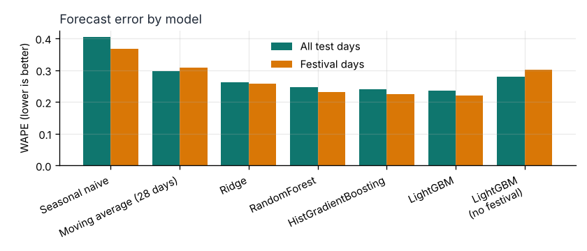
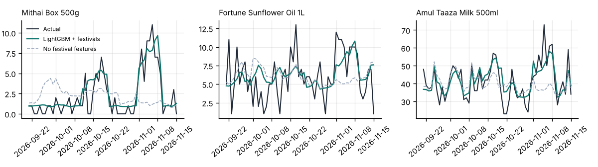
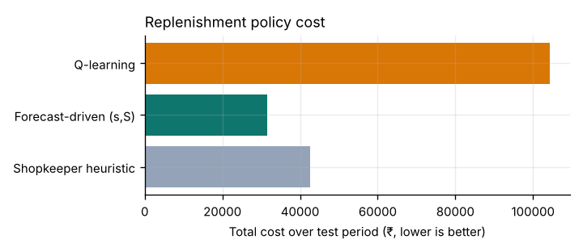
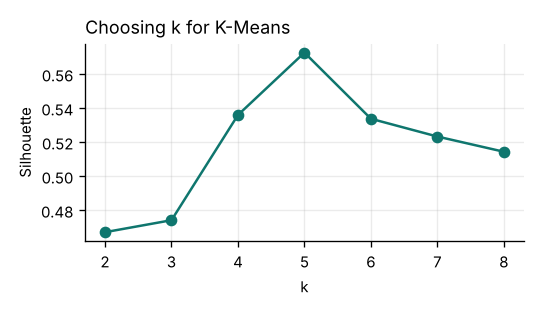

# Smart Retail OS: ML evaluation report

Generated by `ml/run_all.py` on synthetic kirana data (seed 42, 2025-01-01 → 2026-11-15). Python 3.13.18. Re-run to reproduce every number.

> **Data note:** real shop data is private, so data is generated with *planted* Indian retail structure (festivals, paydays, weekday rhythm, seasonal items, basket templates, customer personas). Planting the structure lets us also measure how well each algorithm *recovers* it. Limitation: real demand has shocks (price hikes, local events) that the generator does not model.

## 1. Sales forecasting (#6)

Global model over 40 SKUs × 684 days. Held-out test = last 56 days (includes Dussehra and Diwali). All lag features are shifted ≥ 7 days → true 7-day-ahead forecasts.

| Model | CV MAE | Test MAE | RMSE | WAPE | MASE | Bias | Festival-window WAPE | Fit (s) |
|---|---|---|---|---|---|---|---|---|
| Seasonal naive (same day last week) | — | 4.498 | 6.389 | 0.405 | 1.262 | 0.012 | 0.367 | 0.0 |
| Moving average (28 days) | — | 3.292 | 4.796 | 0.296 | 0.923 | -0.026 | 0.308 | 0.0 |
| Ridge | 2.645 | 2.912 | 4.154 | 0.262 | 0.817 | 0.032 | 0.257 | 0.1 |
| RandomForest | 2.616 | 2.737 | 3.849 | 0.246 | 0.768 | 0.019 | 0.232 | 45.8 |
| HistGradientBoosting | 2.566 | 2.659 | 3.726 | 0.239 | 0.746 | 0.002 | 0.224 | 3.1 |
| LightGBM | 2.536 | 2.624 | 3.664 | 0.236 | 0.736 | 0.001 | 0.219 | 3.7 |
| LightGBM (no festival features) | 2.636 | 3.113 | 4.522 | 0.280 | 0.873 | -0.032 | 0.301 | 3.4 |

**Best model: LightGBM**: WAPE 0.236 vs 0.405 for the seasonal-naive baseline (42% lower error).
**Festival features ablation:** during festival windows LightGBM WAPE is 0.219 with festival features vs 0.301 without them (27% lower error). This is the project's main novelty claim.

Top features (LightGBM gain share): `rmean_28` 0.77, `ewm_14` 0.12, `same_dow_mean_4` 0.03, `fest_x_lift` 0.02, `festival_lift` 0.01, `dow` 0.01, `dom` 0.01, `promo` 0.00, `fest_intensity` 0.00, `rmean_7` 0.00, `rstd_28` 0.00, `cat_code` 0.00

## 2. Inventory replenishment (#40)

All 40 SKUs simulated over the 56-day test period with supplier lead times, pack sizes, shelf life (FIFO expiry), ₹20 order cost, holding cost and lost-margin stockout penalty.

| Policy | Total cost (₹) | Fill rate | Stockout SKU-days | Wasted units | Orders | Avg stock value (₹) |
|---|---|---|---|---|---|---|
| Shopkeeper heuristic | 42,515 | 95.4% | 141 | 148 | 535 | 60,559 |
| Forecast-driven (s,S) | 31,464 | 99.3% | 32 | 301 | 317 | 78,843 |
| Q-learning | 104,281 | 92.6% | 180 | 448 | 1104 | 349,836 |

The forecast-driven (s,S) policy cuts total inventory cost by **26%** vs the experienced-shopkeeper heuristic (daily refills for perishables, weekly for the rest) and raises the fill rate. Perishables use a newsvendor service level (critical ratio Cu/(Cu+Co)) instead of a flat 95%, because over-ordering milk is expensive.
Lowest-cost policy: **Forecast-driven (s,S)**. Tabular Q-learning (#40's suggested algorithm) does not beat (s,S) on cost, but it ties up 4.4× the working capital and places 1104 orders (vs 317). With only ~240 days of history per SKU, model-based control is the safer production choice; RL is kept as a research comparison.

## 3. Frequently bought together (#35)

26,070 baskets, 40 products, min support 0.01.

| Algorithm | Frequent itemsets | Runtime (s) |
|---|---|---|
| Apriori | 143 | 0.04 |
| FP-Growth | 143 | 0.07 |

Identical itemsets: **True** · FP-Growth speed-up: **0.6×** · Planted-pair precision of top-20 rules: **100%**

| If customer buys | → also buys | Support | Confidence | Lift |
|---|---|---|---|---|
| Agarbatti Pack + Matchbox (10) | Amul Ghee 500ml | 0.014 | 0.69 | 19.61 |
| Amul Ghee 500ml | Agarbatti Pack + Matchbox (10) | 0.014 | 0.40 | 19.61 |
| Agarbatti Pack | Amul Ghee 500ml + Matchbox (10) | 0.014 | 0.36 | 17.95 |
| Amul Ghee 500ml + Matchbox (10) | Agarbatti Pack | 0.014 | 0.69 | 17.95 |
| Vim Bar 200g + Lux Soap 100g | Surf Excel 1kg | 0.015 | 0.66 | 16.94 |
| Surf Excel 1kg | Vim Bar 200g + Lux Soap 100g | 0.015 | 0.38 | 16.94 |
| Vim Bar 200g | Surf Excel 1kg + Lux Soap 100g | 0.015 | 0.34 | 15.20 |
| Surf Excel 1kg + Lux Soap 100g | Vim Bar 200g | 0.015 | 0.66 | 15.20 |
| Amul Ghee 500ml | Agarbatti Pack | 0.020 | 0.57 | 14.98 |
| Agarbatti Pack | Amul Ghee 500ml | 0.020 | 0.53 | 14.98 |

Runtime vs minimum support (where the algorithms differ):

| min support | itemsets | Apriori (s) | FP-Growth (s) |
|---|---|---|---|
| 0.02 | 118 | 0.02 | 0.07 |
| 0.01 | 143 | 0.03 | 0.25 |
| 0.005 | 221 | 0.05 | 0.12 |
| 0.002 | 592 | 0.18 | 0.13 |

FP-Growth was faster in 1/4 settings. With only 40 products Apriori's candidate sets stay small; FP-Growth's advantage grows as support falls and the catalogue grows (a real shop stocks 500 to 2,000 SKUs), which is why the production batch job uses FP-Growth.

## 4. Customer segmentation (#27)

400 known customers; features: recency_days, frequency, monetary_rs, avg_basket_rs, distinct_skus, festive_share (log + standardised). K-Means k chosen by silhouette sweep (best k = 5); GMM by BIC (k = 6); DBSCAN eps from 5-NN distance (eps = 0.95).

| Algorithm | k | Silhouette ↑ | Davies–Bouldin ↓ | Calinski–Harabasz ↑ | ARI vs planted personas ↑ |
|---|---|---|---|---|---|
| KMeans | 5 | 0.573 | 0.730 | 486 | 0.937 |
| GaussianMixture | 6 | 0.553 | 0.858 | 423 | 0.965 |
| DBSCAN | 3 | 0.513 | 0.751 | 305 | 0.516 |
| Agglomerative (Ward) | 5 | 0.569 | 0.734 | 476 | 0.987 |

Segment profiles (medians), used for targeted offers in the app:

| segment             |   recency_days |   frequency |   monetary_rs |   avg_basket_rs |   distinct_skus |   festive_share |   customers |
|:--------------------|---------------:|------------:|--------------:|----------------:|----------------:|----------------:|------------:|
| At risk / lapsed    |             76 |          36 |       12994   |           354.4 |            33   |             0   |          66 |
| Bulk monthly buyers |             12 |          10 |        7822   |           782.8 |            30.5 |             0.1 |          64 |
| Daily regulars      |              0 |         129 |       46793   |           362.8 |            37   |             0.1 |         113 |
| Festive shoppers    |              6 |          18 |        8863   |           514   |            28   |             0.8 |          41 |
| Occasional visitors |              4 |          20 |        6460.5 |           329.6 |            26   |             0.1 |         116 |

## 5. Udhaar (credit) risk

1200 credit accounts, default rate 14.8% (imbalanced, so accuracy is not used).

| Model | CV PR-AUC | Test PR-AUC | ROC-AUC | Precision | Recall | F1 | Recall @ top-20% |
|---|---|---|---|---|---|---|---|
| LogisticRegression | 0.486 | 0.483 | 0.784 | 0.323 | 0.682 | 0.438 | 0.591 |
| RandomForest | 0.445 | 0.427 | 0.779 | 0.377 | 0.591 | 0.460 | 0.545 |
| GradientBoosting | 0.413 | 0.334 | 0.730 | 0.400 | 0.409 | 0.404 | 0.455 |

Logistic regression confusion matrix (test, threshold 0.5): `[[193, 63], [14, 30]]`.
It is deployed **on the phone** as plain coefficients (`spec/udhaar_model.json`), so scoring works offline with zero inference cost, and its weights are explainable to the shopkeeper:

| Feature | Weight (standardised) |
|---|---|
| days_since_payment | +0.58 |
| pay_ratio_90d | -0.45 |
| utilisation | +0.36 |
| avg_days_to_repay | +0.23 |
| tenure_days | -0.18 |
| late_payments | +0.15 |
| reminders_ignored | -0.00 |

**Ethics:** the model uses payment behaviour only, with no demographic or protected attributes. It is decision support (it suggests a reminder or a lower credit limit) and never blocks a sale.

## Figures

_Total runtime 70s._
